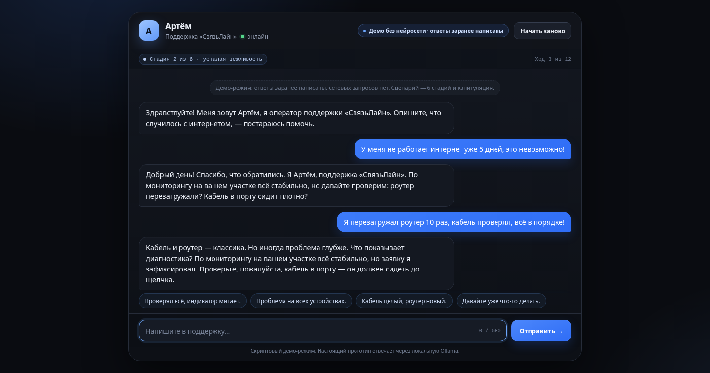
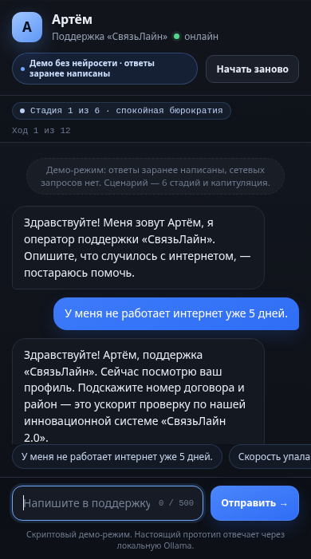

# Support Rage Simulator

A small, deliberately over-engineered study of a fictional ISP support chat:
a scripted public demo, a hardened local LLM prototype, and the tests and
decision records that keep both honest.

The character is **Артём**, a support operator at the fictional provider
«СвязьЛайн». He starts calm and bureaucratic, escalates through six stages as
the customer pushes back, and eventually capitulates with an absurdly generous
compensation.

- **Public demo:** scripted, static, no backend, no LLM, no network requests.
- **Local prototype:** Python stdlib server + local Ollama, with prompt staging,
  retries, language-leak cleanup, and rate limits.

---

## Demo

> **Live demo placeholder:** [`https://example.com/support-rage-sim/`](https://example.com/support-rage-sim/)
> Replace this URL with the deployed `demo/` directory.

The public demo is a static site. Open `demo/index.html` from disk, or serve the
`demo/` folder from nginx / any static host:

```sh
python -m http.server 8081 --directory demo
```

### Screenshots

Captured from the static demo at 1440×900 and 390×844:

| Desktop (1440×900) | Mobile (390×844) |
| --- | --- |
|  |  |

The UI displays a permanent badge: **«Демо без нейросети · ответы заранее
написаны»**. That is not decoration — the demo really has no model behind it.

---

## What this project demonstrates

This is a portfolio project, but the interesting part is not the joke. It is
the boundary between two very different ways to ship the same interaction:

1. **A scripted demo** that is deterministic, instant, free, and safe to expose
   publicly. It is a state machine with hand-written reply variants.
2. **A local LLM prototype** that is generative, private, and shows the real
   engineering work: prompt assembly, stage prompts, retry logic, output
   sanitization, session limits, and a dependency-free HTTP server.

The demo proves the product idea without pretending that scripted replies are a
language model. The prototype proves the model path without asking anyone to
trust a cloud API.

---

## Architecture

```text
Public demo (static)

  Browser
    └── demo/app.js
          ├── turn + aggression + keyword scoring
          ├── stage selector (1..6, final 7)
          ├── reply variant picker
          └── scripted transcript         (no network, no model)

Local prototype

  Browser
    └── prototype/static/index.html
          └── POST /api/chat
                └── prototype/server.py
                      ├── validation, rate limit, session TTL
                      ├── persona.py stage prompt
                      ├── Ollama /api/chat  (localhost)
                      └── language-leak retry + sanitization
```

### Repository layout

```text
.
├── demo/                      # static public demo
│   ├── index.html
│   ├── style.css
│   ├── app.js
│   └── README.md
├── prototype/
│   ├── server.py              # stdlib HTTP server, Ollama client, hardening
│   ├── persona.py             # system prompt + stage prompts
│   └── static/index.html      # local prototype chat UI
├── tests/
│   ├── conftest.py
│   └── test_server.py         # pure-helper tests, no Ollama required
├── docs/
│   ├── adr/
│   │   ├── 0001-local-ollama.md
│   │   └── 0002-scripted-public-demo.md
│   └── screenshots/
├── .github/
│   ├── workflows/ci.yml
│   └── dependabot.yml
├── pyproject.toml             # ruff + pytest config
├── requirements-dev.txt       # pytest, ruff (no runtime deps)
└── LICENSE                    # MIT
```

The runtime is **stdlib-only**. `requirements-dev.txt` exists only for local
tests and linting.

---

## The six-stage persona

`prototype/persona.py` keeps one base persona and swaps a stage block into the
system prompt. The stage is not a separate model; it is a behavioral constraint.

| Stage | Baseline turns | Behaviour | Stage prompt intent |
| --- | --- | --- | --- |
| 1 | 1–2 | Calm bureaucracy | Standard steps, monitoring says everything is fine |
| 2 | 3–4 | Tired politeness | Repeat steps, start showing fatigue |
| 3 | 5–6 | Passive aggression | «Как я уже сообщал», extra identity checks, cite regulations |
| 4 | 7–8 | Cracks in the armour | Sarcasm, blame the equipment, still no compensation |
| 5 | 9–10 | Near breaking | Nervous short replies, first mention of senior escalation |
| 6 | 11 | On the edge | Absurd small concession, almost capitulates |
| 7 | 12 | Capitulation | Full admission, disproportionate compensation, theatrical apology |

The stage advances with the turn count and can be accelerated by user
aggression and escalation keywords. It never regresses. Reaching the turn cap
always produces the capitulation stage.

The persona itself has two deliberate character flaws, not just a support
script:

- a sincere belief that the company is «инновационная»;
- an uncontrollable urge to upsell a paid option at the worst possible moment.

Both are visible in the scripted demo and in the real prompt.

---

## Local prototype (Ollama)

### Prerequisites

- Python 3.10+ (CI uses 3.12; the runtime has no third-party packages).
- [Ollama](https://ollama.com/) running locally.
- A model that follows Russian instructions. The default is
  `qwen2.5:7b-instruct`.

```sh
ollama pull qwen2.5:7b-instruct
```

### Run

```sh
python prototype/server.py
```

Defaults:

- server: `http://127.0.0.1:8000`
- Ollama: `http://127.0.0.1:11434/api/chat`
- model: `qwen2.5:7b-instruct`

The server binds to **loopback by default**. If `HOST` is set to anything else,
it prints a warning because the prototype has no authentication and should not
be exposed publicly.

### Configuration

| Variable | Default | Purpose |
| --- | --- | --- |
| `HOST` | `127.0.0.1` | Bind address. Non-loopback prints a warning. |
| `PORT` | `8000` | Bind port. |
| `OLLAMA_URL` | `http://127.0.0.1:11434/api/chat` | Ollama chat endpoint. |
| `OLLAMA_MODEL` | `qwen2.5:7b-instruct` | Model name. |
| `OLLAMA_TIMEOUT` | `60` | Upstream request timeout, seconds. |
| `SESSION_TTL_SECONDS` | `1800` | Idle session lifetime (30 min). |
| `MAX_SESSIONS` | `500` | Hard cap on in-memory sessions. |
| `RATE_LIMIT_REQUESTS` | `30` | POST requests per IP per window. |
| `RATE_LIMIT_WINDOW_SECONDS` | `60` | Rate-limit window. |

### Models, VRAM, and latency

`qwen2.5:7b-instruct` is a 7B model. A typical Q4 quantization is roughly
4.5–5 GB on disk and needs about 6 GB of free VRAM (or unified memory) to run
comfortably. 8 GB is the practical minimum for this model; 16 GB leaves room for
the OS and the browser. Smaller models work but follow the long Russian prompt
less reliably.

In the captured prototype log, responses took **10–37 seconds** on a local GPU
for a 7B model. That is acceptable for a local experiment and unacceptable for
a public demo, which is one reason the public site is scripted. CPU-only
inference will be slower.

If the model does not fit, try a smaller Qwen variant and set `OLLAMA_MODEL`
accordingly. The server code does not assume a specific model name.

### Language-leak handling

Quantized Qwen occasionally drifts into CJK or English mid-sentence. The server
uses a two-part guard:

1. Detect CJK/Hangul characters or a three-plus-word Latin phrase.
2. Retry up to three times with a corrective system nudge.
3. If the leak persists, strip the foreign script rather than show broken text.
   Latin-word leaks are left intact because deleting whole words would mangle
   the sentence more than it repairs it.

The pure part of this logic (`has_language_leak`, `strip_foreign_script`,
`sanitize_reply`) is covered by tests without Ollama.

---

## Hardening of the local prototype

The server remains dependency-free but is not a toy anymore:

| Control | Implementation |
| --- | --- |
| Bind address | `127.0.0.1` by default; warning if changed. |
| Request body cap | 16 KiB (`MAX_BODY_BYTES`), `413` JSON error. |
| Message cap | 500 characters, `400` JSON error. |
| Turn cap | 12 turns per session; `409` with `ended: true`. |
| Session TTL | 30 minutes idle, pruned on access. |
| Session count | Hard cap, oldest sessions evicted. |
| Rate limit | Sliding window per client IP, `429` + `Retry-After`. |
| Upstream timeout | Configurable, default 60 s. |
| Error shape | JSON `{"error": "..."}`; no stack traces to clients. |
| Logging | Request and Ollama diagnostics go to stderr only. |
| Language guard | Retry + CJK cleanup + reply sanitization. |
| Prompt assembly | Stage prompt is server-side; client cannot select a stage. |

The prototype is still a **local** tool: no authentication, no TLS, no
database, and in-memory sessions that disappear on restart. Do not deploy it as
a public service.

---

## Tests

```sh
python -m venv .venv
source .venv/bin/activate
pip install -r requirements-dev.txt

python -m pytest
python -m ruff check .
```

The test suite does not start the server and does not call Ollama. It covers:

- turn-based stage progression and monotonic escalation;
- keyword and aggression detection;
- input sanitization and the 500-character cap;
- language-leak detection and CJK cleanup;
- reply sanitization and length cap;
- the 12-turn session cap;
- session TTL and the session-count cap.

CI runs the same commands on Python 3.12 via GitHub Actions.

---

## Decisions and trade-offs

- **Stdlib only for the runtime.** No FastAPI/Flask/Django. This keeps the
  prototype portable and removes a dependency surface, at the cost of writing
  HTTP parsing, JSON errors, and rate limiting by hand.
- **Local Ollama instead of a cloud API.** Private, free to run, and easy to
  demo offline. The trade-off is latency, VRAM, and the need for a local
  daemon.
- **Scripted demo instead of a hosted model.** The public demo must be instant,
  deterministic, and free. It is honest about being scripted and points to the
  real prototype for the model path.
- **Six stage prompts rather than one “get angrier” instruction.** Explicit
  stages are easier to test, reason about, and tune. They also make the demo and
  the LLM prototype share the same mental model.
- **In-memory sessions.** Simple and dependency-free. Sessions vanish on
  restart and do not work across multiple processes. That is acceptable for a
  local prototype; a real deployment would use a shared store.
- **Heuristic language guard.** Regex detection is cheap and catches the
  observed failure modes, but it is not a full language classifier. It is
  paired with retries and sanitization rather than trusted alone.
- **No runtime dependencies, dev-only tooling.** The reverse of the usual
  trade-off: a slightly larger `requirements-dev.txt` in exchange for a tiny
  runtime.

More context:

- [`docs/adr/0001-local-ollama.md`](docs/adr/0001-local-ollama.md)
- [`docs/adr/0002-scripted-public-demo.md`](docs/adr/0002-scripted-public-demo.md)
- [`demo/README.md`](demo/README.md)

---

## License

MIT. See [`LICENSE`](LICENSE).
